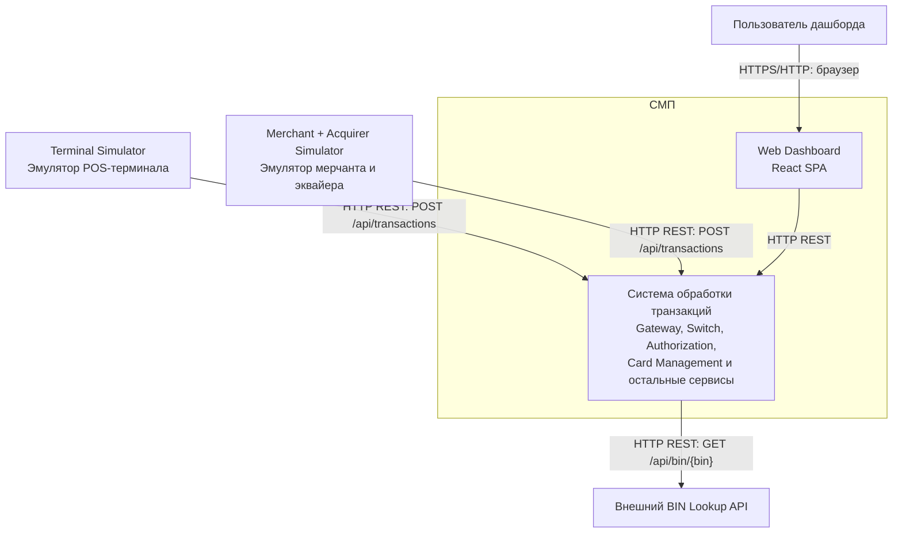

## Диаграмма C4 Level 1 — Context

### Чего не хватало в проекте и что улучшено

Чего не хватало в проекте: отдельной C4-диаграммы уровня Context, которая показывает границы СМП, внешних акторов и протоколы их взаимодействия с системой.
Что улучшено: создана диаграмма, на которой отображены четыре внешних участника: Terminal Simulator, Merchant + Acquirer Simulator, пользователь дашборда и внешний BIN Lookup. 
Добавлены связи с системой и указаны протоколы взаимодействия. Это позволяет определить границы тестирования и понять, какие внешние системы нужно эмулировать или заглушать при E2E-тестировании.

### Подтверждение кодом (ссылки на классы/файлы)

| Элемент диаграммы | Файл проекта | Что подтверждает |
|---|---|---|
| Gateway | [application.yml](https://github.com/LektonSoftwareTestingCourse/Practic/blob/main/services/gateway/src/main/resources/application.yml) | Маршруты API и перенаправление запросов |
| Terminal Simulator | [GatewayClient.java](https://github.com/LektonSoftwareTestingCourse/Practic/blob/main/services/terminal-simulator/src/main/java/com/processing/terminalsimulator/client/GatewayClient.java) | Отправку HTTP-запросов на /api/transactions |
| REST API терминального симулятора | [TerminalSimulatorController.java](https://github.com/LektonSoftwareTestingCourse/Practic/blob/main/services/terminal-simulator/src/main/java/com/processing/terminalsimulator/controller/TerminalSimulatorController.java) | Обработку REST-запросов |
| Merchant + Acquirer Simulator | [GatewayClient.java](https://github.com/LektonSoftwareTestingCourse/Practic/blob/main/services/merchant-acquirer/src/main/java/com/processing/merchantacquirer/client/GatewayClient.java) | HTTP-вызовы Gateway для отправки транзакций |
| REST API симулятора мерчанта | [SimulationController.java](https://github.com/LektonSoftwareTestingCourse/Practic/blob/main/services/merchant-acquirer/src/main/java/com/processing/merchantacquirer/controller/SimulationController.java) | REST-эндпоинты симулятора |
| Вызов BIN Lookup | [BinLookupClient.java](https://github.com/LektonSoftwareTestingCourse/Practic/blob/main/services/authorization/src/main/java/com/processing/authorization/client/BinLookupClient.java) | HTTP GET-запрос к /api/bin/{bin} |
| API BIN Lookup | [BinLookupController.java](https://github.com/LektonSoftwareTestingCourse/Practic/blob/main/services/bin-lookup/src/main/java/com/processing/binlookup/controller/BinLookupController.java) | Обработку запросов поиска BIN |
| Web Dashboard | [App.tsx](https://github.com/LektonSoftwareTestingCourse/Practic/blob/main/services/dashboard/src/App.tsx) | Корневой компонент интерфейса |
| Запросы Dashboard к API | [useTransactions.ts](https://github.com/LektonSoftwareTestingCourse/Practic/blob/main/services/dashboard/src/hooks/useTransactions.ts) | Получение данных о транзакциях |
| WebSocket Dashboard | [useWebSocket.ts](https://github.com/LektonSoftwareTestingCourse/Practic/blob/main/services/dashboard/src/hooks/useWebSocket.ts) | Получение обновлений через WebSocket |
| Конфигурация сервисов | [docker-compose.yaml](https://github.com/LektonSoftwareTestingCourse/Practic/blob/main/docker-compose.yaml) | Состав сервисов, порты и внутренние URL |

