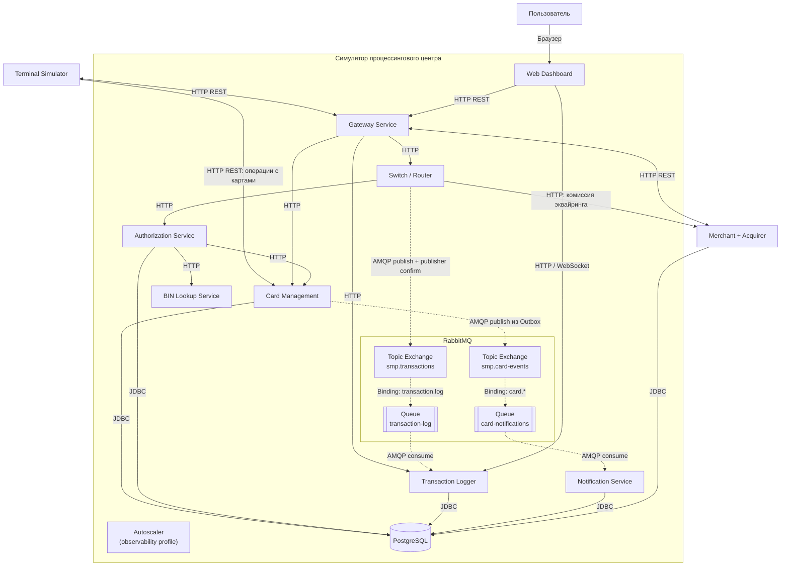

## Диаграмма C4 Level 2 — Container

### Диаграмма

### Чего не хватало в проекте и что улучшено

**Чего не хватало:** в существующей архитектурной диаграмме не различались синхронные и асинхронные связи. Не были наглядно отражены асинхронные потоки Switch -> RabbitMQ -> Transaction Logger и Card Management Outbox -> RabbitMQ -> Notification Service. Также требовалось сверить состав контейнеров с docker-compose.yaml

**Что улучшено:** на диаграмме сплошными стрелками обозначены синхронные взаимодействия HTTP/JDBC, а пунктирными - асинхронный обмен AMQP. Добавлены RabbitMQ exchange и queue для двух потоков, показана связь Outbox с доставкой уведомлений, а также PostgreSQL и основные сервисы системы

### Подтверждение кодом (ссылки на классы/файлы)

| Элемент диаграммы | Файл проекта | Что подтверждает |
|---|---|---|
| Состав контейнеров и инфраструктура | [docker-compose.yaml](https://github.com/LektonSoftwareTestingCourse/Practic/blob/main/docker-compose.yaml) | Сервисы, PostgreSQL, RabbitMQ, зависимости и адреса взаимодействия |
| Маршрутизация Gateway | [application.yml](https://github.com/LektonSoftwareTestingCourse/Practic/blob/main/services/gateway/src/main/resources/application.yml) | HTTP-маршруты к Switch, Card Management, Transaction Logger, Terminal Simulator и Merchant Simulator |
| Вызов BIN Lookup | [BinLookupClient.java](https://github.com/LektonSoftwareTestingCourse/Practic/blob/main/services/authorization/src/main/java/com/processing/authorization/client/BinLookupClient.java) | Синхронный HTTP-запрос для определения эмитента по BIN |
| Вызов Card Management | [CardManagementClientImpl.java](https://github.com/LektonSoftwareTestingCourse/Practic/blob/main/services/authorization/src/main/java/com/processing/authorization/client/CardManagementClientImpl.java) | HTTP-взаимодействие Authorization с Card Management |
| Синхронные вызовы из Switch | [AuthorizationClient.java](https://github.com/LektonSoftwareTestingCourse/Practic/blob/main/services/switch/src/main/java/com/processing/service/AuthorizationClient.java), [MerchantAcquirerClient.java](https://github.com/LektonSoftwareTestingCourse/Practic/blob/main/services/switch/src/main/java/com/processing/service/MerchantAcquirerClient.java) | HTTP-вызовы сервисов авторизации и эквайринга |
| Настройка publisher confirms | [application.yml](https://github.com/LektonSoftwareTestingCourse/Practic/blob/main/services/switch/src/main/resources/application.yml) | Настройку подтверждений публикации RabbitMQ (publisher-confirm-type: correlated) |
| Exchange и queue транзакций | [RabbitMQConfig.java — Switch](https://github.com/LektonSoftwareTestingCourse/Practic/blob/main/services/switch/src/main/java/com/processing/config/RabbitMQConfig.java) | Exchange smp.transactions, routing key transaction.log, очередь transaction-log и DLX/DLQ |
| Публикация транзакций | [LoggerClient.java](https://github.com/LektonSoftwareTestingCourse/Practic/blob/main/services/switch/src/main/java/com/processing/service/LoggerClient.java) | Отправку событий транзакций в RabbitMQ |
| Получение транзакций | [TransactionLogListener.java](https://github.com/LektonSoftwareTestingCourse/Practic/blob/main/services/transaction-logger/src/main/java/com/processing/transactionlogger/listener/TransactionLogListener.java) | Асинхронное получение сообщений из transaction-log |
| Outbox и события карт | [OutboxEventProcessorImpl.java](https://github.com/LektonSoftwareTestingCourse/Practic/blob/main/services/card-management/src/main/java/com/processing/cardmanagement/services/OutboxEventProcessorImpl.java) | Публикацию событий Outbox в RabbitMQ |
| Exchange и queue событий карт | [RabbitMQConfig.java — Card Management](https://github.com/LektonSoftwareTestingCourse/Practic/blob/main/services/card-management/src/main/java/com/processing/cardmanagement/config/RabbitMQConfig.java) | Exchange smp.card-events, очередь card-notifications и routing key card.* |
| Получение событий карт | [CardEventListener.java](https://github.com/LektonSoftwareTestingCourse/Practic/blob/main/services/notification-service/src/main/java/com/processing/notification/listener/CardEventListener.java) | Получение событий из card-notifications и сохранение уведомлений |
| WebSocket Dashboard | [WebSocketConfig.java](https://github.com/LektonSoftwareTestingCourse/Practic/blob/main/services/transaction-logger/src/main/java/com/processing/transactionlogger/websocket/WebSocketConfig.java), [useWebSocket.ts](https://github.com/LektonSoftwareTestingCourse/Practic/blob/main/services/dashboard/src/hooks/useWebSocket.ts) | WebSocket-соединение для отображения обновлений транзакций |
| Подключение к PostgreSQL | [application.properties — Card Management](https://github.com/LektonSoftwareTestingCourse/Practic/blob/main/services/card-management/src/main/resources/application.properties), [application.yaml — Authorization](https://github.com/LektonSoftwareTestingCourse/Practic/blob/main/services/authorization/src/main/resources/application.yaml), [application.yaml — Transaction Logger](https://github.com/LektonSoftwareTestingCourse/Practic/blob/main/services/transaction-logger/src/main/resources/application.yaml) | Настройки подключения сервисов к PostgreSQL |