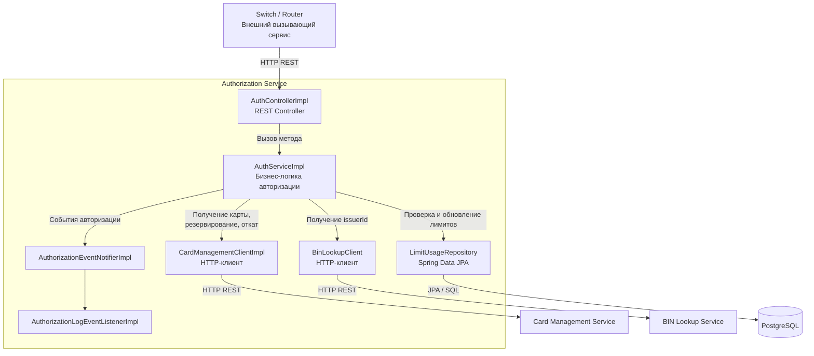
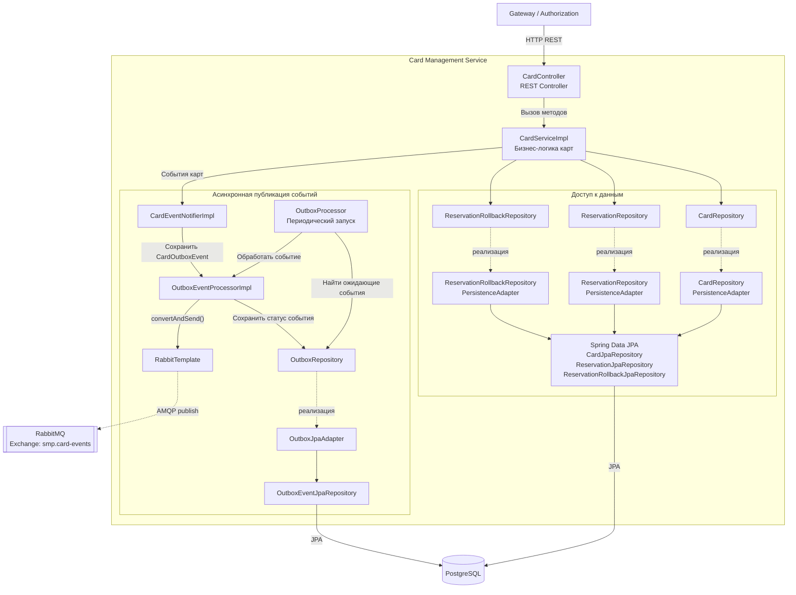

# Диаграмма C4 Level 3 — Component

## 1. Authorization Service

### Диаграмма

### Подтверждение кодом

| Компонент | Исходный файл | Что подтверждает |
|---|---|---|
| Контроллер | [AuthControllerImpl.java](https://github.com/LektonSoftwareTestingCourse/Practic/blob/main/services/authorization/src/main/java/com/processing/authorization/controller/AuthControllerImpl.java) | Эндпоинты /api/internal/authorize и /api/internal/rollback |
| Бизнес-логика | [AuthServiceImpl.java](https://github.com/LektonSoftwareTestingCourse/Practic/blob/main/services/authorization/src/main/java/com/processing/authorization/services/AuthServiceImpl.java) | Проверки карты, баланса и лимитов, резервирование средств и откат |
| HTTP-клиент Card Management | [CardManagementClientImpl.java](https://github.com/LektonSoftwareTestingCourse/Practic/blob/main/services/authorization/src/main/java/com/processing/authorization/client/CardManagementClientImpl.java) | HTTP-запросы для получения карты, резервирования и отката |
| HTTP-клиент BIN Lookup | [BinLookupClient.java](https://github.com/LektonSoftwareTestingCourse/Practic/blob/main/services/authorization/src/main/java/com/processing/authorization/client/BinLookupClient.java) | Получение информации об эмитенте по BIN |
| Репозиторий лимитов | [LimitUsageRepository.java](https://github.com/LektonSoftwareTestingCourse/Practic/blob/main/services/authorization/src/main/java/com/processing/authorization/repositories/LimitUsageRepository.java) | Хранение и обновление данных об использовании лимитов |
| Уведомление о событиях | [AuthorizationEventNotifierImpl.java](https://github.com/LektonSoftwareTestingCourse/Practic/blob/main/services/authorization/src/main/java/com/processing/authorization/events/AuthorizationEventNotifierImpl.java) | Передачу событий слушателям |
| Обработчик событий | [AuthorizationLogEventListenerImpl.java](https://github.com/LektonSoftwareTestingCourse/Practic/blob/main/services/authorization/src/main/java/com/processing/authorization/listeners/AuthorizationLogEventListenerImpl.java) | Логирование успешных и отклонённых операций |

### Чего не хватало в проекте и что улучшено

**Чего не хватало:** компонентной диаграммы Authorization Service, показывающей внутренние зависимости между контроллером, бизнес-логикой, HTTP-клиентами и репозиторием лимитов.

**Что улучшено:** выделены основные компоненты сервиса и подписаны их взаимодействия. Теперь видно, где проверять бизнес-логику изолированно, где тестировать HTTP-контракты, а где проверять операции с данными лимитов.

---

## 2. Card Management Service

### Диаграмма

### Подтверждение кодом

| Компонент | Исходный файл | Что подтверждает |
|---|---|---|
| Контроллер | [CardController.java](https://github.com/LektonSoftwareTestingCourse/Practic/blob/main/services/card-management/src/main/java/com/processing/cardmanagement/controllers/CardController.java) | REST-операции создания, получения, изменения карт, резервирования и отката |
| Бизнес-логика | [CardServiceImpl.java](https://github.com/LektonSoftwareTestingCourse/Practic/blob/main/services/card-management/src/main/java/com/processing/cardmanagement/services/CardServiceImpl.java) | Работу с картами, резервами, откатами и событиями |
| Репозиторий карт | [CardRepository.java](https://github.com/LektonSoftwareTestingCourse/Practic/blob/main/services/card-management/src/main/java/com/processing/cardmanagement/repositories/CardRepository.java) | Интерфейс доступа к данным карт |
| Адаптер карт | [CardRepositoryPersistenceAdapter.java](https://github.com/LektonSoftwareTestingCourse/Practic/blob/main/services/card-management/src/main/java/com/processing/cardmanagement/repositories/CardRepositoryPersistenceAdapter.java) | Реализацию репозитория через JPA |
| Репозитории резервов | [ReservationRepositoryPersistenceAdapter.java](https://github.com/LektonSoftwareTestingCourse/Practic/blob/main/services/card-management/src/main/java/com/processing/cardmanagement/repositories/ReservationRepositoryPersistenceAdapter.java), [ReservationRollbackRepositoryPersistenceAdapter.java](https://github.com/LektonSoftwareTestingCourse/Practic/blob/main/services/card-management/src/main/java/com/processing/cardmanagement/repositories/ReservationRollbackRepositoryPersistenceAdapter.java) | Сохранение резервов и операций отката |
| Уведомление о событиях | [CardEventNotifierImpl.java](https://github.com/LektonSoftwareTestingCourse/Practic/blob/main/services/card-management/src/main/java/com/processing/cardmanagement/events/CardEventNotifierImpl.java) | Передачу событий Outbox на сохранение |
| Планировщик Outbox | [OutboxProcessor.java](https://github.com/LektonSoftwareTestingCourse/Practic/blob/main/services/card-management/src/main/java/com/processing/cardmanagement/services/OutboxProcessor.java) | Периодический поиск необработанных событий |
| Обработка и публикация Outbox | [OutboxEventProcessorImpl.java](https://github.com/LektonSoftwareTestingCourse/Practic/blob/main/services/card-management/src/main/java/com/processing/cardmanagement/services/OutboxEventProcessorImpl.java) | Сохранение статуса события и публикацию в RabbitMQ |
| Репозиторий Outbox | [OutboxJpaAdapter.java](https://github.com/LektonSoftwareTestingCourse/Practic/blob/main/services/card-management/src/main/java/com/processing/cardmanagement/repositories/OutboxJpaAdapter.java), [OutboxEventJpaRepository.java](https://github.com/LektonSoftwareTestingCourse/Practic/blob/main/services/card-management/src/main/java/com/processing/cardmanagement/repositories/OutboxEventJpaRepository.java) | Доступ к таблице Outbox |
| Конфигурация RabbitMQ | [RabbitMQConfig.java](https://github.com/LektonSoftwareTestingCourse/Practic/blob/main/services/card-management/src/main/java/com/processing/cardmanagement/config/RabbitMQConfig.java) | Exchange smp.card-events, очередь card-notifications и настройки DLX/DLQ |

### Чего не хватало в проекте и что улучшено

**Чего не хватало:** компонентной диаграммы Card Management Service, раскрывающей структуру контроллера, бизнес-логики, репозиториев и механизма Outbox.

**Что улучшено:** показаны основные компоненты доступа к данным и отдельный путь асинхронной публикации событий: событие сохраняется через Outbox, периодически выбирается обработчиком и публикуется через RabbitTemplate в RabbitMQ. Это позволяет отдельно тестировать операции с БД, бизнес-логику и доставку событий.

**Примечание:** в этих компонентах используются Spring Data JPA и SQL-запросы, поэтому на диаграмме указан JPA/SQL, а не отдельный прямой JDBC-клиент.