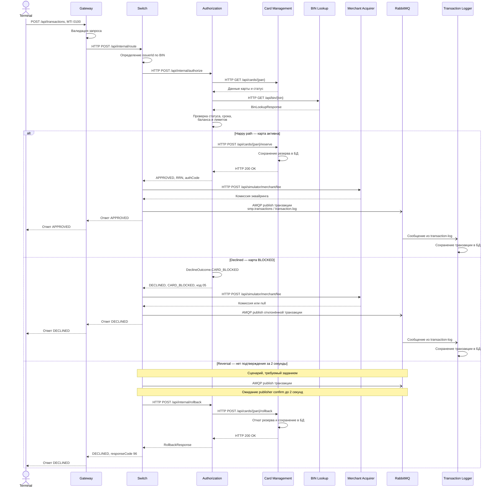

# Диаграмма А4 - Sequence

## Диаграмма последовательности

## Подтверждение кодом (ссылки на классы/файлы)

| Этап | Файл проекта | Что подтверждает |
|---|---|---|
| Валидация и перенаправление запроса | [TransactionValidationFilter.java](https://github.com/LektonSoftwareTestingCourse/Practic/blob/main/services/gateway/src/main/java/com/processing/gateway/validation/TransactionValidationFilter.java), [application.yml](https://github.com/LektonSoftwareTestingCourse/Practic/blob/main/services/gateway/src/main/resources/application.yml) | Валидацию запроса и маршрут Gateway → Switch |
| Начало маршрутизации | [RouteController.java](https://github.com/LektonSoftwareTestingCourse/Practic/blob/main/services/switch/src/main/java/com/processing/controller/RouteController.java), [RouteService.java](https://github.com/LektonSoftwareTestingCourse/Practic/blob/main/services/switch/src/main/java/com/processing/service/RouteService.java) | Приём запроса, оркестрацию вызовов и публикацию транзакции |
| Маршрутизация по BIN | [RoutingService.java](https://github.com/LektonSoftwareTestingCourse/Practic/blob/main/services/switch/src/main/java/com/processing/service/RoutingService.java) | Определение issuerId по BIN |
| Вызов Authorization | [AuthorizationClient.java](https://github.com/LektonSoftwareTestingCourse/Practic/blob/main/services/switch/src/main/java/com/processing/service/AuthorizationClient.java), [AuthControllerImpl.java](https://github.com/LektonSoftwareTestingCourse/Practic/blob/main/services/authorization/src/main/java/com/processing/authorization/controller/AuthControllerImpl.java) | HTTP-вызов авторизации и возврат результата |
| Проверка карты и лимитов | [AuthServiceImpl.java](https://github.com/LektonSoftwareTestingCourse/Practic/blob/main/services/authorization/src/main/java/com/processing/authorization/services/AuthServiceImpl.java), [BinLookupClient.java](https://github.com/LektonSoftwareTestingCourse/Practic/blob/main/services/authorization/src/main/java/com/processing/authorization/client/BinLookupClient.java) | Проверки статуса, срока действия, баланса и лимитов; HTTP-вызов BIN Lookup |
| Резервирование и откат средств | [CardManagementClientImpl.java](https://github.com/LektonSoftwareTestingCourse/Practic/blob/main/services/authorization/src/main/java/com/processing/authorization/client/CardManagementClientImpl.java), [CardController.java](https://github.com/LektonSoftwareTestingCourse/Practic/blob/main/services/card-management/src/main/java/com/processing/cardmanagement/controllers/CardController.java), [CardServiceImpl.java](https://github.com/LektonSoftwareTestingCourse/Practic/blob/main/services/card-management/src/main/java/com/processing/cardmanagement/services/CardServiceImpl.java) | HTTP-операции резервирования и отката, изменение данных в БД |
| Отказ по заблокированной карте | [DeclineOutcome.java](https://github.com/LektonSoftwareTestingCourse/Practic/blob/main/services/authorization/src/main/java/com/processing/authorization/constants/DeclineOutcome.java), [AuthServiceImpl.java](https://github.com/LektonSoftwareTestingCourse/Practic/blob/main/services/authorization/src/main/java/com/processing/authorization/services/AuthServiceImpl.java) | Результат CARD_BLOCKED и код отказа 05 |
| Публикация транзакции | [LoggerClient.java](https://github.com/LektonSoftwareTestingCourse/Practic/blob/main/services/switch/src/main/java/com/processing/service/LoggerClient.java), [RabbitMQConfig.java](https://github.com/LektonSoftwareTestingCourse/Practic/blob/main/services/switch/src/main/java/com/processing/config/RabbitMQConfig.java) | Публикацию сообщения через exchange smp.transactions с routing key transaction.log |
| Асинхронное получение транзакции | [TransactionLogListener.java](https://github.com/LektonSoftwareTestingCourse/Practic/blob/main/services/transaction-logger/src/main/java/com/processing/transactionlogger/listener/TransactionLogListener.java) | Получение сообщения из очереди и передачу на сохранение |
| Ответ DECLINED, код 96 | [RouteService.java](https://github.com/LektonSoftwareTestingCourse/Practic/blob/main/services/switch/src/main/java/com/processing/service/RouteService.java), [AuthorizationResponse.java](https://github.com/LektonSoftwareTestingCourse/Practic/blob/main/services/common/src/main/java/com/processing/common/dto/authorization/AuthorizationResponse.java) | Откат при ошибке публикации и формирование системного отказа |

## Чего не хватало в проекте и что улучшено

**Чего не хватало:** существующая sequence-диаграмма в docs/architecture.md показывала только успешный сценарий. Не были отдельно раскрыты отказ по заблокированной карте и сценарий reversal при проблеме с публикацией в RabbitMQ.

**Что улучшено:** добавлены три ветки обработки транзакции. На схеме различены синхронные HTTP-вызовы и асинхронная публикация через RabbitMQ, показаны резервирование средств, обработка отказа и путь отката.

**Расхождение с текущим кодом:** в switch/application.yml включён publisher-confirm-type: correlated, но LoggerClient.log() не ожидает подтверждение в течение двух секунд и не обрабатывает его результат. В RouteService откат вызывается, когда LoggerClient.log() возвращает false, например при AmqpException. При этом AuthorizationResponse.systemError() формирует DECLINED с кодом 96 и MTI 0110; отдельного сообщения с MTI 0400 в просмотренном исходнике нет.

Поэтому ветка reversal на диаграмме отражает требуемый заданием сценарий, но **тайм-аут publisher confirm в 2 секунды и MTI 0400 пока не подтверждаются текущей реализацией**.