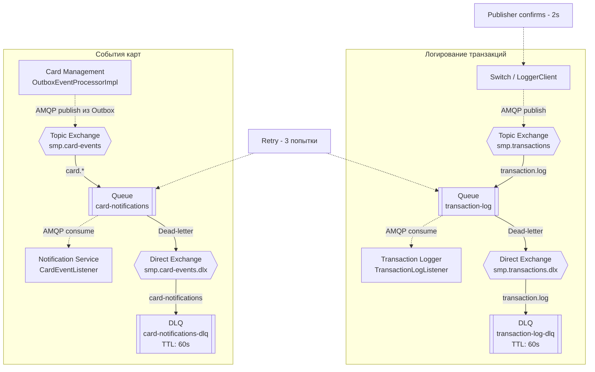

# Диаграмма А5. RabbitMQ-топология

## Диаграмма

## Подтверждение кодом (ссылки на классы/файлы)

| Элемент диаграммы | Файл проекта | Что подтверждает |
|---|---|---|
| Exchange, queue и DLX/DLQ транзакций | [RabbitMQConfig.java — Switch](https://github.com/LektonSoftwareTestingCourse/Practic/blob/main/services/switch/src/main/java/com/processing/config/RabbitMQConfig.java) | Названия smp.transactions, transaction-log, smp.transactions.dlx и transaction-log-dlq, routing key и настройки очередей |
| Публикация транзакций | [LoggerClient.java](https://github.com/LektonSoftwareTestingCourse/Practic/blob/main/services/switch/src/main/java/com/processing/service/LoggerClient.java) | Отправку сообщения в RabbitMQ через rabbitTemplate.convertAndSend() |
| Настройка publisher confirms | [application.yml — Switch](https://github.com/LektonSoftwareTestingCourse/Practic/blob/main/services/switch/src/main/resources/application.yml) | Настройку publisher-confirm-type: correlated и publisher-returns: true |
| Получение транзакций | [TransactionLogListener.java](https://github.com/LektonSoftwareTestingCourse/Practic/blob/main/services/transaction-logger/src/main/java/com/processing/transactionlogger/listener/TransactionLogListener.java) | Получение сообщений из очереди транзакций |
| Exchange, queue и DLX/DLQ событий карт | [RabbitMQConfig.java — Card Management](https://github.com/LektonSoftwareTestingCourse/Practic/blob/main/services/card-management/src/main/java/com/processing/cardmanagement/config/RabbitMQConfig.java) | Названия smp.card-events, card-notifications, smp.card-events.dlx и card-notifications-dlq, routing key и настройки очередей |
| Публикация событий из Outbox | [OutboxEventProcessorImpl.java](https://github.com/LektonSoftwareTestingCourse/Practic/blob/main/services/card-management/src/main/java/com/processing/cardmanagement/services/OutboxEventProcessorImpl.java) | Публикацию событий карт в exchange smp.card-events с routing key, начинающимся с card. |
| Получение событий карт | [CardEventListener.java](https://github.com/LektonSoftwareTestingCourse/Practic/blob/main/services/notification-service/src/main/java/com/processing/notification/listener/CardEventListener.java) | Получение и обработку событий карт сервисом уведомлений |
| Конфигурация RabbitMQ в Transaction Logger | [RabbitMQConfig.java — Transaction Logger](https://github.com/LektonSoftwareTestingCourse/Practic/blob/main/services/transaction-logger/src/main/java/com/processing/transactionlogger/config/RabbitMQConfig.java) | Настройки exchange и основной очереди для получения транзакций |

## Чего не хватало в проекте и что улучшено

**Чего не хватало:** топология RabbitMQ была описана текстом и таблицей, но отсутствовала единая визуальная диаграмма. Потоки публикации и получения сообщений, а также связь основных очередей с DLX/DLQ не были представлены на одной схеме.

**Что улучшено:** создана диаграмма двух асинхронных потоков:
- Switch -> smp.transactions -> transaction-log -> Transaction Logger.
- Card Management Outbox -> smp.card-events -> card-notifications -> Notification Service.

## Расхождения с требованиями задания

- **Publisher confirms (2 секунды).** В application.yml настроен publisher-confirm-type: correlated, однако в LoggerClient явно не реализовано ожидание подтверждения с таймаутом 2 секунды.
- **Retry (3 попытки).** В конфигурации очередей указан аргумент x-max-delivery = 3, но наличие этого аргумента само по себе не подтверждает полноценную реализацию повторных попыток доставки.
- **TTL (60 секунд).** TTL 60 секунд задан для DLQ. Отдельная retry-очередь с TTL 60 секунд в рассмотренной конфигурации не объявлена.

Диаграмма отражает имеющуюся в проекте топологию. Недостающие механизмы обозначены как расхождения с требованиями, а не как уже реализованная функциональность.