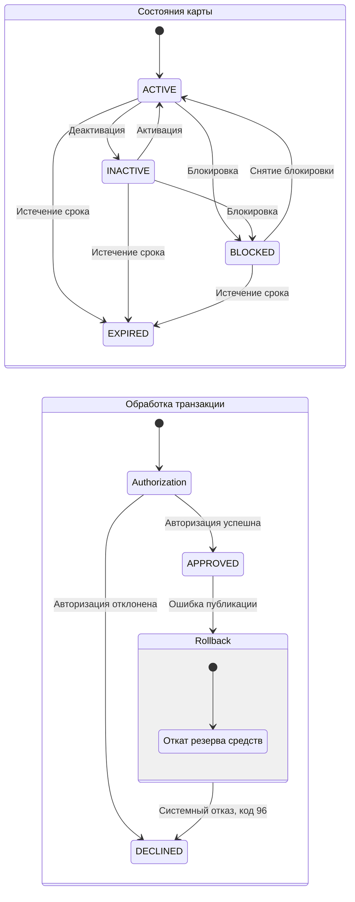

# Диаграмма А6. State-transition

## Диаграмма состояний

## Подтверждение кодом

| Элемент | Файл проекта | Что подтверждает |
|---|---|---|
| Статусы карты | [CardStatus.java](https://github.com/LektonSoftwareTestingCourse/Practic/blob/main/services/card-management/src/main/java/com/processing/cardmanagement/models/CardStatus.java) | Статусы ACTIVE, INACTIVE, BLOCKED, EXPIRED, DELETED |
| Изменение статуса карты | [CardServiceImpl.java](https://github.com/LektonSoftwareTestingCourse/Practic/blob/main/services/card-management/src/main/java/com/processing/cardmanagement/services/CardServiceImpl.java) | Методы patchCard() и bulkUpdateStatus() |
| Проверка карты | [AuthServiceImpl.java](https://github.com/LektonSoftwareTestingCourse/Practic/blob/main/services/authorization/src/main/java/com/processing/authorization/services/AuthServiceImpl.java) | Проверку статуса и срока действия карты |
| Результаты авторизации | [TransactionStatus.java](https://github.com/LektonSoftwareTestingCourse/Practic/blob/main/services/common/src/main/java/com/processing/common/dto/transactionlogger/TransactionStatus.java) | Статусы APPROVED и DECLINED |
| Обработка ошибки публикации | [RouteService.java](https://github.com/LektonSoftwareTestingCourse/Practic/blob/main/services/switch/src/main/java/com/processing/service/RouteService.java) | Вызов отката и формирование системного отказа |
| Откат резерва | [CardServiceImpl.java](https://github.com/LektonSoftwareTestingCourse/Practic/blob/main/services/card-management/src/main/java/com/processing/cardmanagement/services/CardServiceImpl.java) | Логику отката зарезервированных средств |

## Чего не хватало и что сделано

В проекте отсутствовала диаграмма переходов состояний. Добавлена схема, показывающая основные переходы карты, результаты авторизации и сценарий отката резерва при ошибке публикации.

**Ограничения реализации:**
- PROCESSING и ROLLED_BACK отсутствуют в TransactionStatus, поэтому не показаны как статусы транзакции.
- Откат выполняется отдельной операцией, после которой формируется DECLINED с кодом 96.
- Переходы карты на диаграмме отражают предполагаемую последовательность основных действий, а не формально заданные в коде ограничения переходов.
- DELETED есть в enum, но отдельные переходы для него не показаны.